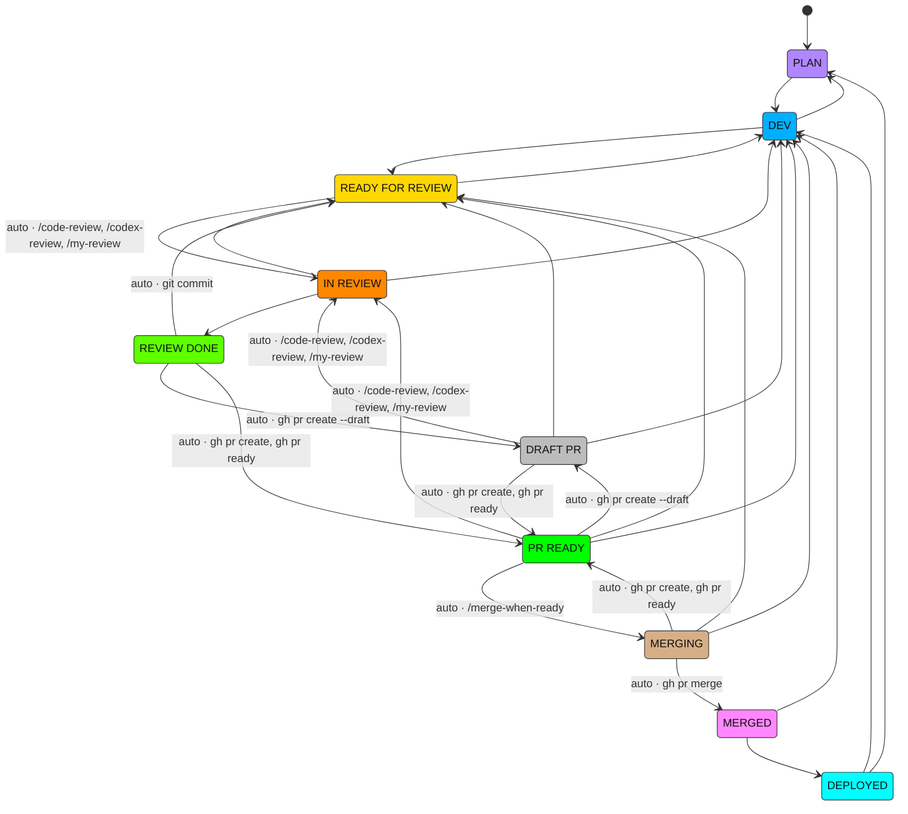
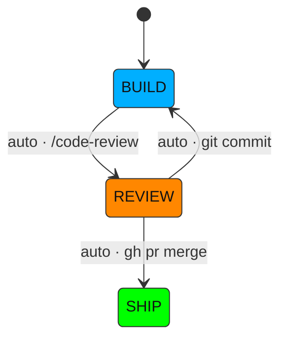

**To install, paste this into any AI coding agent (Claude Code, Codex or anything else):**

```text
Install ai-state-machine from https://github.com/fraser-langton/ai-state-machine into the AI coding tool you are running in.

1. Clone the repo into a temporary directory. Read README.md, bin/asm, machine.default.json and scripts/install.sh.
2. If you are Claude Code, Codex or Cursor: run `bash <clone>/scripts/install.sh --claude`, `--codex` or `--cursor`. It needs jq and sqlite3; if either is missing, tell me how to install it.
3. If you are any other tool: copy bin/asm to ~/.ai-state-machine/bin/asm and machine.default.json to ~/.ai-state-machine/machine.json. Then find out how the tool runs hooks and configures its status line. Wire `bash ~/.ai-state-machine/bin/asm hook` to its session-start, prompt-submit and after-tool events, passing the event JSON on stdin. If its status line can run a command, make it run `asm statusline` and keep the existing one by saving its command to ~/.ai-state-machine/wrapped-statusline. Back up any config file before changing it.
4. If Claude Code or Codex is also installed on this machine, ask me whether to set that one up too.
5. Tell me what you changed, where the backups are, and whether I need to restart anything.
```

# ai-state-machine

Know where every AI coding session is in your workflow. You define the states and the allowed moves between them. Hooks move the session automatically when something observable happens, the agent moves it the rest of the way, and a progress line under your status line shows the result:

```
Model: Opus 5.5 | Effort: high | 5h: 42% (1h30m) | 7d: 81% (2d7h) | Cost: $1.23
✓ PLAN › ✓ DEV › ✗ READY FOR REVIEW › ✗ IN REVIEW › ✓ REVIEW DONE › ▌PR READY▐ › MERGING › MERGED › DEPLOYED
```

| Mark | Meaning |
| --- | --- |
| highlighted block | the current state |
| `✓` in the state's colour | visited this session |
| red `✗` | skipped: never visited, but a later state was reached |
| dim grey | not reached yet |

Every transition is stored permanently, so you can see how work actually flows.

## How it works

- **`~/.ai-state-machine/`** is the one central home for every harness:
  - `machine.json` is your user-wide state machine (repos can have their own)
  - `state.db` is the transition history
  - `bin/asm` is the CLI
- **History is append-only SQLite.** Each row records time, session, harness, cwd, repo and branch, from-state, to-state, what caused it and whether the move was allowed. `asm reset` appends a reset row; nothing is ever deleted.
- **Hooks** (session start, prompt submit, after a tool runs) apply your triggers. At session start they also tell the agent the current state, what each state means and how to move it.
- **The agent** runs `asm set "<STATE>"` for the moves no hook can see, such as "the review came back clean".
- **The status line** runs your existing status line command and adds the progress line underneath, so it works alongside [better-ai-status-line](https://github.com/fraser-langton/better-ai-status-line) or anything else.
- **Hooks and the status line start no programs.** They run on every prompt, tool call and redraw, and endpoint security can scan every program started, so those paths use bash builtins only. Each machine is compiled to a small bash cache when its JSON changes, and `sqlite3` runs only when a transition is actually recorded. A hook that doesn't fire takes a few milliseconds, even on a loaded machine.

| Harness | Hooks | Progress line |
| --- | --- | --- |
| Claude Code | plugin `hooks/hooks.json`, or `install.sh --claude` | yes, under your status line |
| Codex | `~/.codex/hooks.json` via `install.sh --codex` (needs `hooks = true` under `[features]`) | no: Codex's status line only shows built-in items, so use `asm get` / `asm log` |
| Cursor CLI | `~/.cursor/hooks.json` via `install.sh --cursor` (`sessionStart`, `beforeSubmitPrompt`, `postToolUse` on Shell) | yes, under the status line in `~/.cursor/cli-config.json` |
| Others | any tool that can run a command on events with JSON on stdin | if its status line can run a command |

## Install (Claude Code)

Requires `bash`, `jq` and `sqlite3`.

```
/plugin install ai-state-machine --marketplace fraser-langton/ai-state-machine
/ai-state-machine:setup
```

Setup copies `asm` to `~/.ai-state-machine/bin`, creates `machine.json` from the default if you don't have one, and wraps your status line, backing up `settings.json` first. Add `--codex` to wire Codex too.

### Manual install

```sh
git clone https://github.com/fraser-langton/ai-state-machine
bash ai-state-machine/scripts/install.sh            # sets up Claude Code and Codex if present
bash ai-state-machine/scripts/install.sh --uninstall  # undo; your machine.json and history are kept
```

## The default machine

A plan → build → local review → PR → merge → deploy workflow. Edges are the allowed transitions. An edge labelled `auto ·` is one a hook takes for you when you run that command or skill. Each state is filled with its status line colour. This diagram is generated from [`machine.default.json`](machine.default.json) by `asm diagram`.



## Customise the state machine

A machine is one JSON file. `asm` picks one the way skills do, so a repo can carry its own workflow:

1. `$ASM_MACHINE`, if set
2. the nearest `.ai-state-machine/machine.json`, walking up from the current folder, so a repo's own machine wins
3. `~/.ai-state-machine/machine.json`, your user-wide machine
4. the bundled default

The status line and hooks resolve it from the session's folder, so each session follows its repo's workflow. Every transition records the machine's `name`, so history stays separable.

```sh
asm init       # give this repo its own machine: copies the one in effect to <repo>/.ai-state-machine/machine.json
asm which      # which machine applies here
asm validate   # check it
asm diagram    # draw it as Mermaid; paste into any .md, as below
```

Commit `.ai-state-machine/machine.json` to share a repo's workflow with your team.

### Example: a three-state machine

```json
{
  "name": "review-only",
  "states": [
    { "name": "BUILD", "color": 39, "description": "Writing the change." },
    { "name": "REVIEW", "color": 208, "description": "Local review running or being addressed." },
    { "name": "SHIP", "color": 46, "description": "Merged." }
  ],
  "transitions": {
    "BUILD": ["REVIEW"],
    "REVIEW": ["BUILD", "SHIP"]
  },
  "triggers": [
    { "label": "/code-review", "on": "prompt", "match": "^[[:space:]]*/code-review", "to": "REVIEW" },
    { "label": "git commit", "on": "command", "match": "git commit", "from": ["REVIEW"], "to": "BUILD" },
    { "label": "gh pr merge", "on": "command", "match": "gh pr merge", "to": "SHIP" }
  ]
}
```

`asm diagram` draws it as:



| Field | Meaning |
| --- | --- |
| `name` | Recorded on every transition, so you can tell workflows apart in the history. |
| `states[]` | Display order. `color` is a 256-colour ANSI code, and `description` is what the agent is told the state means. |
| `transitions` | Each state's allowed next states. `asm set` refuses anything else unless you pass `--force`, and records that move with `allowed = 0`. Leave `transitions` out to allow any move. |
| `triggers[]` | Automatic moves, first match wins. `on` is `prompt` (what the user typed), `skill` (a skill the agent called) or `command` (a shell command the agent ran). `match` and `unless` are POSIX extended regexes, the flavour bash `[[ =~ ]]` uses: write `[[:space:]]` rather than `\s`, and `([^A-Za-z0-9_-]|$)` for a word end rather than `\b`; `asm validate` rejects one that doesn't compile. `from` limits it to certain current states, and `label` names the edge in the diagram. A trigger always records what happened; if the move isn't an allowed transition it's flagged `allowed = 0`. |

## CLI

```
asm set <STATE> [--force] [--reason TEXT]   move this session (names are case-insensitive: asm set "in review")
asm get                                     current state
asm states                                  states, allowed next states and descriptions
asm log [--all] [--limit N]                 history for this session, or every session
asm reset [--reason TEXT]                   start this session's progress over
asm validate                                check machine.json
asm which | init | diagram                  see "Customise the state machine"
```

The session comes from `--session`, else `$ASM_SESSION_ID`, `$CLAUDE_CODE_SESSION_ID` or `$CODEX_THREAD_ID`. In Claude Code, `/ai-state-machine:state [STATE|log|states|reset]` does the same.

### Analyse the history

```sh
sqlite3 ~/.ai-state-machine/state.db "
  SELECT to_state, COUNT(*) FROM transitions WHERE to_state <> '' GROUP BY 1 ORDER BY 2 DESC;"
sqlite3 ~/.ai-state-machine/state.db "
  SELECT repo, from_state, to_state, source FROM transitions WHERE allowed = 0;"   -- skipped or forced moves
```

## Options

| Variable | Effect |
| --- | --- |
| `ASM_HOME` | Central home. Default `~/.ai-state-machine`. |
| `ASM_MACHINE` | Use this machine file everywhere, ignoring repo and user machines. |
| `ASM_SESSION_ID` | Override the session ID. |

## Tests

```sh
bash tests/run.sh
```

## License

MIT
